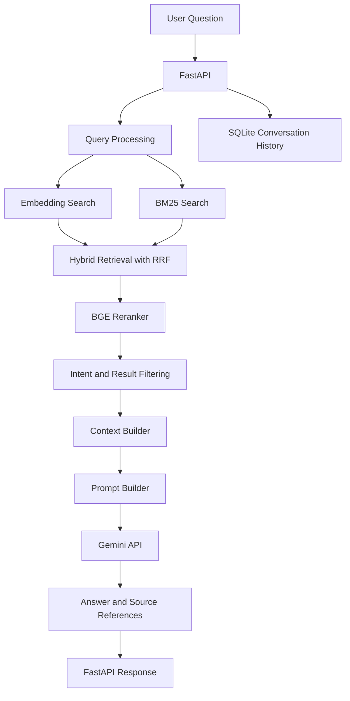

# Hospital Medication Knowledge Assistant (HMKA)

**Version:** 1.0.0

A Retrieval-Augmented Generation (RAG) application for answering Vietnamese medication-related questions using a collection of drug information documents. The system retrieves relevant information, reranks candidate passages, generates grounded answers with an LLM, and returns source references through a REST API.

## Overview

Finding specific medication information across multiple documents can be time-consuming. HMKA aims to make this process easier by allowing users to ask questions in natural language and receive answers grounded in retrieved drug information.

The system is designed to prioritize source-grounded responses and avoid answering unsupported questions with fabricated information.

### Key Features

- **Hybrid Retrieval:** Combines semantic vector search and BM25 keyword search.
- **Reciprocal Rank Fusion (RRF):** Combines rankings from different retrieval methods.
- **Cross-Encoder Reranking:** Uses BGE reranking to improve the relevance of retrieved passages.
- **RAG Pipeline:** Builds context from retrieved documents and generates answers using the Gemini API.
- **Query Rewriting:** Uses conversation history to help interpret follow-up questions.
- **Source References:** Returns drug names, document sections, and source URLs.
- **Conversation History:** Stores user and assistant messages in SQLite.
- **Out-of-Scope Handling:** Rejects unsupported question categories and returns a predefined response when applicable.
- **REST API:** Provides endpoints through FastAPI.
- **Docker Support:** Runs the application using Docker Compose.

## System Architecture



## Technology Stack

| Component | Technology |
|---|---|
| Programming Language | Python |
| API Framework | FastAPI |
| API Server | Uvicorn |
| Embedding Model | `BAAI/bge-m3` |
| Vector Database | ChromaDB |
| Keyword Retrieval | BM25 (`rank-bm25`) |
| Hybrid Retrieval | Reciprocal Rank Fusion |
| Reranking Model | `BAAI/bge-reranker-v2-m3` |
| LLM | Google Gemini API |
| Conversation Storage | SQLite and SQLAlchemy |
| Deployment | Docker and Docker Compose |

## RAG Workflow

1. **Query processing:** Receives the user's question and optionally uses recent conversation history to rewrite follow-up queries.
2. **Hybrid retrieval:** Retrieves candidate passages using semantic embeddings and BM25 keyword matching.
3. **Rank fusion:** Combines retrieval rankings using Reciprocal Rank Fusion.
4. **Reranking:** Applies a BGE cross-encoder reranker to prioritize relevant passages.
5. **Filtering:** Applies medication intent and section-based filtering to reduce irrelevant context.
6. **Context construction:** Formats selected passages with drug names, section titles, and source URLs.
7. **Answer generation:** Sends the question and retrieved context to Gemini with grounding instructions.
8. **Response and persistence:** Returns the answer and source references, then stores the conversation in SQLite.

## Project Structure

```text
HMKA/
├── src/
│   ├── api/                 # FastAPI routes and schemas
│   ├── core/                # Core database components
│   ├── embedding/           # Embedding model
│   ├── rag/                 # RAG pipeline, prompts, context and LLM
│   ├── retrieval/            # BM25, vector and hybrid retrieval
│   └── reranking/            # Cross-encoder reranker
├── scripts/
│   ├── embedding/            # Embedding-related scripts
│   └── ingestion/            # Data ingestion scripts
├── evaluation/
│   ├── api/                  # API and database tests
│   ├── embedding/            # Embedding evaluation
│   ├── rag/                  # RAG evaluation and filtering tests
│   └── retrieval/            # Retrieval evaluation and tests
├── Dockerfile
├── docker-compose.yml
├── requirements.txt
├── requirements-docker.txt
├── .env.example
├── .gitignore
└── README.md
```

*Note: The structure above summarizes the main components. Keep it consistent with the files actually committed to the repository.*

## Getting Started

### Prerequisites

- Docker Desktop with Docker Compose
- A Gemini API key
- Internet access for downloading model weights on the first run

### 1. Clone the Repository

```bash
git clone <YOUR_GITHUB_REPOSITORY_URL>
cd HMKA
```

Replace `<YOUR_GITHUB_REPOSITORY_URL>` with the actual repository URL.

### 2. Configure Environment Variables

Create a `.env` file from the example:

**PowerShell**

```powershell
Copy-Item .env.example .env
```

Configure the required values in `.env`:

```dotenv
FIRECRAWL_API_KEY=your_firecrawl_key_here
GEMINI_API_KEY=your_gemini_api_key_here
```

Use your own API key. Never commit `.env` or expose API credentials in source code.

### 3. Prepare the Data and Vector Index

The application expects its processed chunks and vector database to be available under the `data/` directory.

The required artifacts include:

- `data/chunks/chunks.jsonl`
- `data/vector_db/chroma/`

The BM25 index is built from the chunks file during application initialization. The ChromaDB collection must contain embeddings compatible with the configured embedding model.

**Important:** The local data and vector index are not included in the repository. Follow the project's data preparation and indexing scripts to recreate them before starting the application.

### 4. Build and Start the Application

```bash
docker compose build
docker compose up -d
```

Check the container status:

```bash
docker compose ps
```

View application logs:

```bash
docker compose logs -f hmka-api
```

The first startup may take longer because the application downloads and loads its embedding and reranking models.

### 5. Verify the Application

Health check:

```text
http://localhost:8000/health
```

Interactive API documentation:

```text
http://localhost:8000/docs
```

The health endpoint should return:

```json
{
  "status": "ok"
}
```

## API Endpoints

### Health Check

`GET /health`

Checks whether the API is available.

### Chat

`POST /api/v1/chat`

Example request:

```json
{
  "query": "Thành phần hoạt chất của thuốc Techepa là gì?"
}
```

Example response structure:

```json
{
  "conversation_id": 16,
  "answer": "Thành phần hoạt chất của thuốc Techepa là L-Ornithin L-Aspartat.",
  "sources": [
    {
      "drug_name": "Techepa",
      "section": "Thành phần hoạt chất",
      "source_url": "https://thuocbietduoc.com.vn/thuoc-53471/techepa.aspx"
    }
  ]
}
```

The answer above is an illustrative response structure based on a local test. Actual answers and source lists depend on the retrieved context.

To continue a conversation, send the returned `conversation_id` in a subsequent request:

```json
{
  "query": "Thuốc này có những chống chỉ định nào?",
  "conversation_id": 16
}
```

### Retrieve Conversation History

`GET /api/v1/conversations/{conversation_id}`

Returns the conversation metadata and stored messages.

## Evaluation

HMKA includes evaluation scripts and tests for several components:

- Embedding model comparisons
- BM25 and vector retrieval
- Hybrid retrieval and rank fusion
- Reranker behavior
- Context construction and prompt building
- Medication filtering and product isolation
- Out-of-scope query handling
- API and database behavior

Evaluation should distinguish retrieval performance from answer quality and out-of-scope detection.

Report quantitative metrics only alongside the test dataset, evaluation setup, and relevant limitations. A successful example does not establish overall medical accuracy.

## Limitations and Safety

- The quality of answers depends on the coverage and accuracy of the underlying drug information documents.
- Retrieved source references do not independently guarantee that every generated statement is correct.
- Out-of-scope detection and retrieval filtering may produce false positives or false negatives.
- The system is an information retrieval and question-answering prototype, not a clinical decision-support system.
- Responses must not replace advice from qualified healthcare professionals.
- Model downloads and Gemini API requests require internet connectivity; Gemini API usage may incur costs or quota limits.
- The application has been tested locally with Docker. Public production deployment, authentication, rate limiting, and production-grade monitoring are not implied by the local setup.

## Future Improvements

- Expand automated evaluation with a reviewed question-answer dataset.
- Improve source selection and reduce irrelevant citations.
- Strengthen out-of-scope detection and abstention behavior.
- Add automated integration tests for the full API workflow.
- Add a user-facing chat interface.
- Introduce production deployment controls, authentication, monitoring, and resource management.

## License and Data Attribution

Add a project license and document the data sources and their applicable usage terms before public release. Do not redistribute third-party drug information unless permitted by the relevant source's terms.

---

**HMKA v1.0.0 — A Vietnamese medication knowledge assistant built with RAG and FastAPI.**